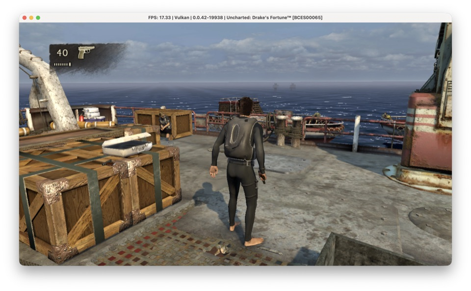
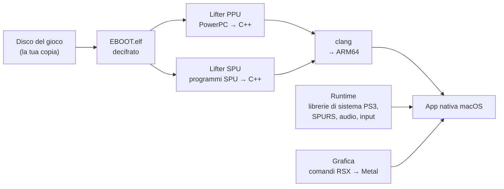

# ps3-uncharted

**Uncharted: Drake's Fortune (PS3, 2007) che gira in nativo sui Mac con Apple
Silicon.** Non è emulato, è *ricompilato*: il codice del gioco viene tradotto in
C++, compilato per ARM64 e disegnato con Metal.

🇬🇧 [Read in English](README.md)

<table>
<tr>
<td width="50%"></td>
<td width="50%"></td>
</tr>
<tr>
<td align="center"><b>Questo port</b>: app nativa macOS</td>
<td align="center">La stessa scena in RPCS3, l'emulatore di riferimento</td>
</tr>
</table>

> **Stato: lavori in corso.** Il gioco si avvia, arriva al menu principale,
> salva e carica il primo livello a circa **28 fotogrammi al secondo**
> (l'originale punta a 30). Non si gioca ancora da cima a fondo.

---

## Di cosa si tratta, in parole semplici

Di solito i giochi delle vecchie console girano su PC o Mac tramite un
**emulatore**: un programma che finge di essere la console e interpreta le
istruzioni del gioco una alla volta, mentre gira. Funziona, ma è pesante.

La **ricompilazione statica** fa un'altra strada. Il programma del gioco viene
tradotto *una volta sola*, in anticipo, in codice sorgente normale, e quel
codice viene compilato in una normale app per Mac. Mentre giochi non si
interpreta niente: la logica del gioco gira come codice nativo sul processore
del Mac.

Il problema è che la PS3 è una macchina molto particolare, e "tradurre il
codice" è solo l'inizio. Questo progetto riguarda tutto il resto: i sei
processori ausiliari della PS3, il suo chip grafico e le librerie di sistema di
Sony che il gioco si aspetta di trovare.

Il repository è un fork di [**ps3recomp**](https://github.com/sp00nznet/ps3recomp)
di sp00nznet, un toolkit generale per ricompilare giochi PS3. ps3-uncharted
porta quel toolkit su **macOS** e lo spinge su un gioco preciso e molto
esigente. Lo sviluppo è indipendente dal progetto originale.

## Cosa funziona

| | |
|---|---|
| ✅ Avvio | Risolti tutti i 172 import delle librerie di sistema che servono al gioco |
| ✅ Caricamento | Livelli, banchi audio, dati delle cinematiche, sottotitoli |
| ✅ Menu | Menu principale leggibile e usabile, "New Game" crea il salvataggio |
| ✅ Primo livello | `dive-boat` a schermo con HUD, luci, ombre e post-processing |
| ✅ Personaggi | Drake intero e animato; morte e ripartenza dal checkpoint |
| ✅ Audio | Suono in gioco senza gracchiare |
| ✅ Velocità | ~28 fps nel livello (si partiva da 8) |
| ⏳ Stabilità | Si sta cercando un blocco intermittente, circa 1 partita su 10-15 |
| ⏳ Oltre | Il resto del gioco non è ancora stato provato |

Provato su un MacBook Pro con **Apple M4 Pro** e 48 GB di memoria.

## Come funziona



Il processore della PS3 è il **Cell**: un core generico (la **PPU**) più sei
core ausiliari piccoli e velocissimi (le **SPU**). Uncharted usa molto le SPU
per animazione, geometria, fisica e audio. Il port tratta ogni parte a sé:

1. **Programma principale (PPU).** L'eseguibile viene decifrato dal disco e
   tradotto in C++ da `tools/ppu_lifter.py`: circa **18.600 funzioni, 2,2
   milioni di righe** di codice generato, compilate in ARM64 nativo.
2. **Processori ausiliari (SPU).** I programmi SPU vengono tradotti allo stesso
   modo e girano su normali thread del Mac, con una nostra implementazione di
   **SPURS**, lo scheduler di Sony che distribuisce il lavoro alle SPU.
3. **Librerie di sistema.** Tutto quello che il gioco chiede al sistema operativo
   della PS3 (file, salvataggi, controller, audio, video, thread e lock) è
   reimplementato in `runtime/` e `libs/`.
4. **Grafica.** I comandi che il gioco manda alla GPU della PS3 (la **RSX**)
   vengono letti e tradotti in **Metal**, compresi gli shader del gioco,
   convertiti al volo nel linguaggio di Metal.

Quando non è chiaro cosa dovrebbe fare il codice originale, la risposta si
controlla su [RPCS3](https://rpcs3.net/), l'emulatore PS3, invece di tirare a
indovinare.

## Alcuni dei bug incontrati

Per arrivare qui ci sono volute più di 40 sessioni di lavoro, ognuna annotata
con le misure in [`docs/STATO.md`](../docs/STATO.md). Qualche esempio:

- **Lo schermo nero che non era un bug grafico.** Il gioco disegna in una
  vecchia "modalità immediata" (ogni vertice scritto come un registro separato
  della GPU) che al toolkit non era mai servita. A Metal arrivavano zero disegni.
- **Drake senza braccia e gambe.** La SPU non conosce il "NaN": un valore che
  sulla PS3 è solo un numero grande sul Mac è un numero non valido, e
  `0 × non valido` cancellava tutti gli arti. Ora la matematica delle SPU segue
  la specifica del Cell.
- **Il blocco quando Drake muore.** Un lavoro pensato per una sola SPU girava
  su sei contemporaneamente; si sovrascrivevano a vicenda il segnale di "fatto"
  e il gioco aspettava per sempre.
- **L'audio che gracchiava.** Al gioco veniva detta la posizione di lettura come
  un contatore sempre crescente invece che come uno degli 8 blocchi dell'anello,
  quindi scriveva sopra suono non ancora riprodotto. I click sono scesi dal 22%
  dei confini fra blocchi allo 0,1%.
- **Da 8 a 28 fps**, con il salto più grande ottenuto lasciando che ogni SPU
  simulata scelga da sola il proprio lavoro, come fa l'hardware vero, invece di
  aspettare ogni volta la più lenta.

## Compilare

Serve un Mac con Apple Silicon, gli Xcode Command Line Tools e
[Homebrew](https://brew.sh/) (`cmake`, `ninja`).

```bash
export PATH="/opt/homebrew/bin:$PATH"
cmake -B build -G Ninja -DCMAKE_BUILD_TYPE=Release   # configura
cmake --build build                                  # compila runtime e strumenti
```

Questo compila il runtime e gli strumenti. **Nel repository non c'è nessun file
del gioco**, e non ci sarà mai: per costruire il gioco vero serve il proprio
disco e il suo eseguibile decifrato. La ricetta passo per passo che trasforma la
propria copia nell'app per Mac è in [`uncharted/`](../uncharted/README.md) (in inglese).

## Mappa del repository

| Percorso | Contenuto |
|---|---|
| `runtime/ppu/` | Caricamento dell'eseguibile, memoria del gioco, import delle librerie |
| `runtime/spu/` | SPU simulate, DMA, SPURS e job manager |
| `runtime/syscalls/` | Le chiamate di sistema del kernel PS3 (lv2) |
| `libs/` | Librerie di sistema Sony: grafica, audio, input, salvataggi, video… |
| `libs/video/rsx_metal_backend.m` | Il renderer Metal |
| `runtime/host/`, `runtime/platform/` | Finestra, compatibilità macOS e Windows |
| `uncharted/` | Gli script che compilano e avviano il gioco dalla propria copia |
| `tools/` | Lifter PPU e SPU, strumenti di analisi |
| `docs/` | Documentazione tecnica; `STATO.md` è il diario di lavoro |

La mappa completa è in [`ATLANTE.md`](../ATLANTE.md). Il README originale di
ps3recomp è ancora in [`README.md`](../README.md).

## Crediti e note legali

- Costruito su [ps3recomp](https://github.com/sp00nznet/ps3recomp) di sp00nznet,
  licenza MIT.
- [RPCS3](https://rpcs3.net/) come riferimento per il comportamento dell'hardware.
- Sviluppato da Elia Venturi.

*Uncharted: Drake's Fortune* è un marchio di Sony Interactive Entertainment,
sviluppato da Naughty Dog. Questo è un progetto personale di studio, senza scopo
di lucro e senza affiliazioni con nessuno dei due. Non contiene codice né asset
del gioco; per usarlo serve una copia del gioco posseduta legalmente.
