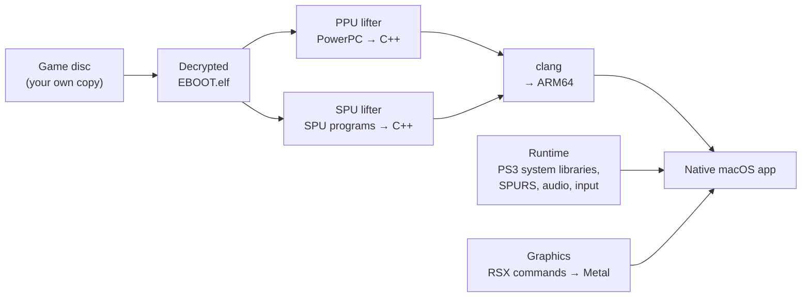

# ps3-uncharted

**Uncharted: Drake's Fortune (PS3, 2007) running natively on Apple Silicon Macs** —
not emulated, but *recompiled*: the game's code is translated into C++, compiled
for ARM64 and drawn with Metal.

🇮🇹 [Leggi in italiano](README.it.md)

<table>
<tr>
<td width="50%"></td>
<td width="50%"></td>
</tr>
<tr>
<td align="center"><b>This port</b> — native macOS app</td>
<td align="center">The same scene in RPCS3, the reference emulator</td>
</tr>
</table>

> **Status: work in progress.** The game boots, reaches the main menu, saves,
> and loads the first level at around **28 frames per second** (the original
> targets 30). It is not yet playable from start to finish.

---

## What is this, in plain words?

Old console games normally run on a PC or Mac through an **emulator**: a
program that pretends to be the console and interprets the game's
instructions one by one, while it runs. That works, but it is heavy.

**Static recompilation** takes a different route. The game's program is
translated *once*, ahead of time, into ordinary source code, and that code is
compiled into a normal Mac app. Nothing is interpreted while you play: the
game's logic runs as native code on the Mac's processor.

The catch is that the PS3 is a very unusual machine, so "just translating the
code" is only the start. This project is about everything else: the PS3's six
helper processors, its graphics chip, and the Sony system libraries the game
expects to find.

This repository is a fork of [**ps3recomp**](https://github.com/sp00nznet/ps3recomp)
by sp00nznet, a general toolkit for recompiling PS3 games. ps3-uncharted takes
that toolkit to **macOS** and pushes it on one specific, very demanding game.
It is developed independently from the original project.

## What works

| | |
|---|---|
| ✅ Boot | All 172 system-library imports the game needs are resolved |
| ✅ Loading | Levels, audio banks, cutscene data, subtitles |
| ✅ Menus | Main menu readable and usable, "New Game" creates a save |
| ✅ First level | `dive-boat` on screen with HUD, lighting, shadows and post-processing |
| ✅ Characters | Drake fully rendered and animated; death and restart from checkpoint |
| ✅ Audio | In-game sound without crackling |
| ✅ Speed | ~28 fps in the level (it started at 8) |
| ⏳ Stability | An intermittent freeze in about 1 run out of 10–15 is being hunted |
| ⏳ Beyond | The rest of the game has not been tested yet |

Tested on a MacBook Pro with an **Apple M4 Pro** and 48 GB of memory.

## How it works



The PS3's processor is a **Cell**: one general-purpose core (the **PPU**) plus
six small, very fast helper cores (the **SPUs**). Uncharted leans heavily on
the SPUs for animation, geometry, physics and audio. The port handles each
piece separately:

1. **Main program (PPU).** The game's executable is decrypted from the disc and
   translated into C++ by `tools/ppu_lifter.py`: about **18,600 functions,
   2.2 million lines** of generated code, compiled to native ARM64.
2. **Helper processors (SPU).** The SPU programs are translated the same way and
   run on ordinary Mac threads, with our own implementation of **SPURS**, the
   Sony job scheduler that hands work out to the SPUs.
3. **System libraries.** Everything the game asks of the PS3 operating system —
   files, saves, controller, audio, video decoding, threads and locks — is
   re-implemented in `runtime/` and `libs/`.
4. **Graphics.** The commands the game sends to the PS3's GPU (the **RSX**) are
   read and translated to **Metal**, including the game's own shader programs,
   which are converted to Metal's shading language on the fly.

When it is unclear what the original code was supposed to do, the answer is
checked against [RPCS3](https://rpcs3.net/), the PS3 emulator, rather than
guessed.

## A few of the bugs along the way

Getting here took 40+ working sessions, each one logged with measurements in
[`docs/STATO.md`](../docs/STATO.md) (in Italian). Some highlights:

- **The black screen that was not a graphics bug.** The game draws in an old
  "immediate mode" (every vertex written as a separate GPU register) that the
  toolkit had never needed. Zero draws were reaching Metal.
- **Drake without arms and legs.** The SPU has no concept of "NaN": a value that
  is simply a big number on the PS3 is an invalid number on a Mac, and
  `0 × invalid` erased every limb. The SPU math now follows the Cell spec.
- **The freeze when Drake dies.** A job meant for exactly one SPU was being run
  on six at once; they overwrote each other's "done" flag and the game waited
  forever.
- **Crackling audio.** The game was told the playback position as an ever-growing
  counter instead of a slot in an 8-block ring, so it wrote over sound that had
  not been played yet. Clicks dropped from 22% of block boundaries to 0.1%.
- **From 8 to 28 fps**, the biggest jump coming from letting each simulated SPU
  pick its own work like the real hardware does, instead of waiting for the
  slowest one every time.

## Building

You need an Apple Silicon Mac, the Xcode Command Line Tools and
[Homebrew](https://brew.sh/) (`cmake`, `ninja`).

```bash
export PATH="/opt/homebrew/bin:$PATH"
cmake -B build -G Ninja -DCMAKE_BUILD_TYPE=Release   # configure
cmake --build build                                  # build the runtime and tools
```

This builds the runtime and the tools. **No game files are included** in this
repository, and none ever will be: to build the actual game you need your own
disc and its decrypted executable. The scripts that build and launch the game
itself are not part of the repository yet.

## Repository map

| Path | What is inside |
|---|---|
| `runtime/ppu/` | Loading the executable, guest memory, system-library imports |
| `runtime/spu/` | Simulated SPUs, DMA, SPURS and the job manager |
| `runtime/syscalls/` | The PS3 kernel (lv2) system calls |
| `libs/` | Sony system libraries: graphics, audio, input, saves, video… |
| `libs/video/rsx_metal_backend.m` | The Metal renderer |
| `runtime/host/`, `runtime/platform/` | Window, macOS and Windows compatibility |
| `tools/` | PPU and SPU lifters, analysis tools |
| `docs/` | Technical docs; `STATO.md` is the work diary |

A complete map is in [`ATLANTE.md`](../ATLANTE.md). The original ps3recomp
README is still in [`README.md`](../README.md).

## Credits and legal

- Built on [ps3recomp](https://github.com/sp00nznet/ps3recomp) by sp00nznet,
  MIT license.
- [RPCS3](https://rpcs3.net/) as the reference for how the hardware behaves.
- Developed by Elia Venturi.

*Uncharted: Drake's Fortune* is a trademark of Sony Interactive Entertainment,
developed by Naughty Dog. This is a personal, non-commercial study project with
no affiliation to either. It contains no game code or assets; you need a legally
owned copy of the game to use it.
