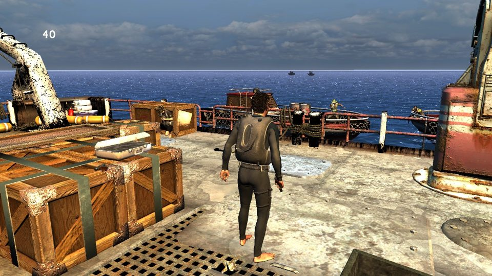

# ps3-uncharted

**Uncharted: Drake's Fortune (PS3) come eseguibile ARM64 nativo su macOS**, tramite
ricompilazione statica. Niente emulatore: il codice del gioco viene tradotto in C++,
compilato per Apple Silicon e disegnato con Metal.



*Primo livello (`dive-boat`), renderizzato dal port su un Mac.*

Fork privato di [sp00nznet/ps3recomp](https://github.com/sp00nznet/ps3recomp)
(licenza MIT), portato su macOS.

## A che punto siamo

Il gioco **parte, arriva al menu, carica il primo livello e si gioca** a circa
**28 fotogrammi al secondo** (su 30 dell'originale). Non è ancora giocabile da
cima a fondo.

| Cosa funziona | Da quando |
|---|---|
| Boot completo, 172 import del firmware su 172 risolti | prime sessioni |
| Caricamento dei livelli, audio, cinematiche, sottotitoli | sessione 19-25 |
| Menu principale leggibile, "New Game" salva e parte | sessione 27 |
| Il livello a schermo con HUD, luci, ombre e post-processing | sessione 29-34 |
| Drake intero e animato; morte e ripartenza dal checkpoint | sessione 33-35 |
| ~28 fps nel livello (da 8) | sessione 36-42 |
| Nessun vertice spazzatura / poligono gigante | sessione 41 |

Lo stato dettagliato, con misure, fallimenti e ipotesi scartate sessione per
sessione, è in [`docs/STATO.md`](../docs/STATO.md).

## Come funziona

La PS3 ha un processore principale (PPU, PowerPC) e sei coprocessori (SPU) che
Uncharted usa in modo intenso per animazione, geometria e audio. Il port:

1. **PPU** — l'eseguibile del gioco viene decifrato e tradotto in C++
   (≈18.600 funzioni, 2,2 milioni di righe) da `tools/ppu_lifter.py`, poi
   compilato in nativo ARM64.
2. **SPU** — i programmi dei coprocessori vengono tradotti allo stesso modo e
   fatti girare su thread dell'host, con un'implementazione propria di SPURS
   (lo scheduler dei job di Sony).
3. **Firmware** — le librerie di sistema della PS3 (grafica, pad, file system,
   salvataggi, audio, video) sono reimplementate in `runtime/`.
4. **Grafica** — i comandi della GPU della PS3 (RSX) vengono letti e tradotti in
   Metal, compresi i vertex e fragment program del gioco convertiti in MSL.

Per capire cosa dovrebbe fare il codice del gioco, il riferimento è
[RPCS3](https://rpcs3.net/).

## Build

Serve un Mac con Apple Silicon, Xcode Command Line Tools e Homebrew.

```bash
export PATH="/opt/homebrew/bin:$PATH"
cmake -B build -G Ninja -DCMAKE_BUILD_TYPE=Release
cmake --build build
```

Il port vero e proprio si costruisce a partire dall'eseguibile decifrato del
proprio disco, che **non è incluso** in questo repository: qui ci sono solo il
runtime e gli strumenti, nessun file del gioco.

## Mappa del repository

| Percorso | Contenuto |
|---|---|
| `runtime/ppu/` | caricamento dell'ELF, memoria del gioco, import del firmware |
| `runtime/spu/` | SPU virtuali, DMA, SPURS e job manager |
| `runtime/syscalls/` | le chiamate di sistema del kernel PS3 (lv2) |
| `runtime/host/`, `runtime/platform/` | finestra, Metal, compatibilità macOS/Windows |
| `tools/` | lifter PPU e SPU, strumenti di analisi |
| `docs/` | documentazione tecnica; `STATO.md` è il diario di lavoro |

La mappa completa è in [`ATLANTE.md`](../ATLANTE.md).

## Note

- Il README originale di ps3recomp è in [`README.md`](../README.md).
- Uncharted è un marchio di Sony Interactive Entertainment. Questo è un progetto
  personale di studio, senza affiliazioni; per usarlo serve una copia legittima
  del gioco.
